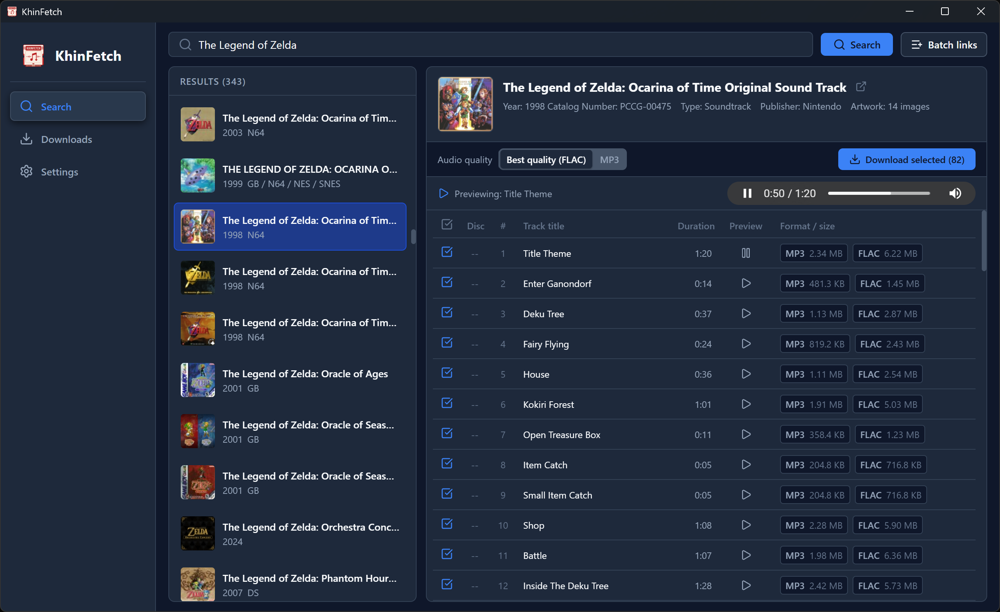
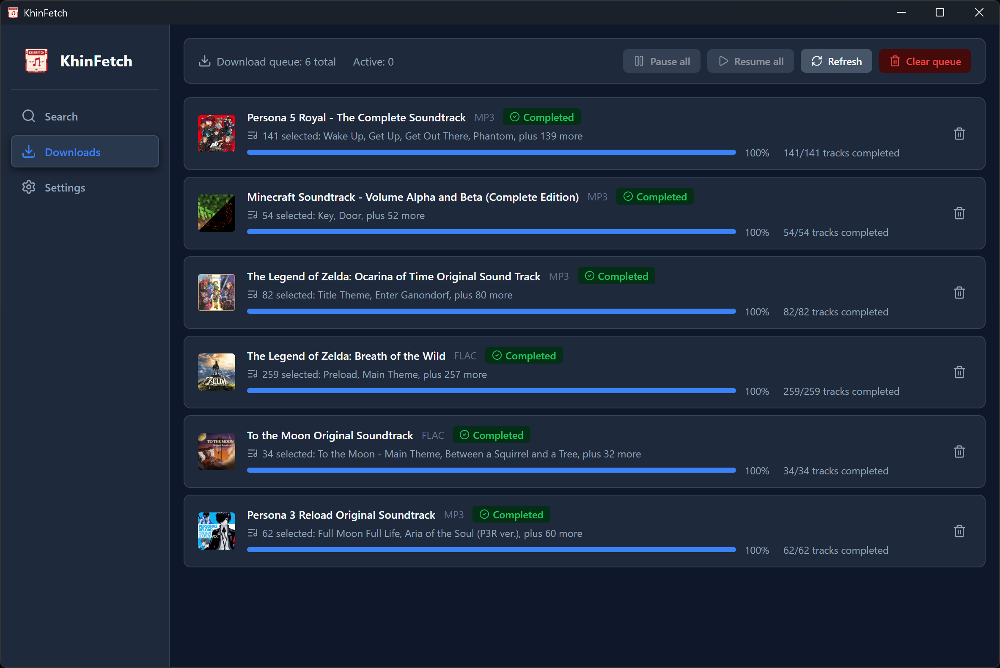

<p align="center">
  
</p>

<h1 align="center">KhinFetch</h1>

<p align="center">
  An unofficial, cross-platform desktop download manager for Khinsider game soundtracks.
</p>

<p align="center">
  <a href="./README.zh-CN.md">简体中文</a>
  ·
  <a href="./LICENSE">GPL-3.0-or-later</a>
</p>

> [!NOTE]
> This project and README were generated with AI assistance.

> [!IMPORTANT]
> KhinFetch is an independent, unofficial client. It is not affiliated with, endorsed by, or maintained by Khinsider. The project does not grant any rights to music, artwork, metadata, or other third-party content. You are responsible for ensuring that your use and downloads are lawful and comply with the applicable website terms.

## Features

- Search Khinsider albums or open an album or playlist URL directly.
- Inspect album metadata, track duration, available formats, and file sizes before downloading.
- Preview available MP3 audio.
- Prefer the best format available for each track, with automatic lossy fallback and clear mixed-quality labels, or download MP3 only.
- Add multiple album and playlist links in a batch.
- Optionally save original album artwork alongside audio files.
- Pause, resume, retry, cancel, and inspect persistent album, track, and artwork jobs.
- Recover interrupted jobs and progress from the SQLite-backed queue.
- Configure concurrency, download quality, artwork, file verification, logging, theme, and interface language.
- Use the interface in English or Simplified Chinese; first launch follows the system language, and the theme can follow the system or be set explicitly.

## Screenshots

### Search



### Download queue



## Status

KhinFetch is under active development. Source builds target Windows, macOS, and Linux, and all three platforms are compiled in CI. GitHub Releases may provide prebuilt packages; unless a release states otherwise, those packages are currently unsigned.

Windows releases also include a portable ZIP archive. Extract it and run `KhinFetch.exe` without installing the application. The portable build still stores settings, its database, and logs in the current user's application data directories.

## Development

### Prerequisites

- Node.js 26.x
- pnpm 11.20.x
- Rust 1.97 or newer
- The platform prerequisites listed in the [Tauri documentation](https://v2.tauri.app/start/prerequisites/)

### Run locally

```bash
pnpm install --frozen-lockfile
pnpm tauri dev
```

### Validate changes

```bash
pnpm lint
pnpm build
cargo fmt --manifest-path src-tauri/Cargo.toml --all -- --check
cargo clippy --manifest-path src-tauri/Cargo.toml --all-targets --locked -- -D warnings
cargo test --manifest-path src-tauri/Cargo.toml --locked
```

### Build the desktop application

```bash
pnpm tauri build
```

Unsigned local bundles are written under `src-tauri/target/release/bundle/` when supported by the host platform.

## Project Structure

- `src/`: React and TypeScript frontend
- `src/api/client.ts`: the frontend boundary for all Tauri backend calls
- `src/api/generated/`: TypeScript types mirrored from Rust DTOs
- `src/i18n/`: Simplified Chinese and English interface strings
- `src/assets/`: frontend and documentation assets
- `docs/images/`: screenshots used in the README files
- `src-tauri/src/`: Rust commands, downloads, parsing, storage, logging, and filesystem logic
- `src-tauri/migrations/`: SQLite migrations
- `src-tauri/icons/`: platform-specific Tauri bundle icons
- `.github/workflows/`: continuous integration and release automation

When changing a public Rust DTO in `src-tauri/src/domain/`, update the corresponding generated TypeScript types in `src/api/generated/` in the same change.

## Contributing

Issues and pull requests are welcome. Keep changes focused, preserve the unofficial-client positioning, and run the validation commands above before submitting a pull request.

## Acknowledgements

- [Khinsider](https://downloads.khinsider.com/) provides the website data consumed by the application.
- The implementation was inspired by the open-source [KhinsiderDownloader](https://github.com/weespin/KhinsiderDownloader) project.

## License

Copyright (C) 2026 KhinFetch contributors.

Unless a file states otherwise, the original KhinFetch source code and project-owned assets in this repository are licensed under the **GNU General Public License, version 3, or (at your option) any later version** (`GPL-3.0-or-later`). You may use, study, modify, and redistribute KhinFetch under those terms. Conveying modified versions or binaries requires compliance with the GPL, including the applicable corresponding-source obligations.

KhinFetch is distributed **without any warranty**; without even the implied warranties of merchantability or fitness for a particular purpose. See the complete license text in [LICENSE](./LICENSE).

Third-party dependencies and content obtained from external services remain subject to their own licenses, copyrights, and terms. The KhinFetch license does not relicense or grant rights to that third-party content.
