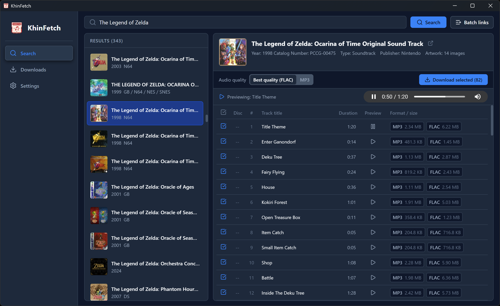
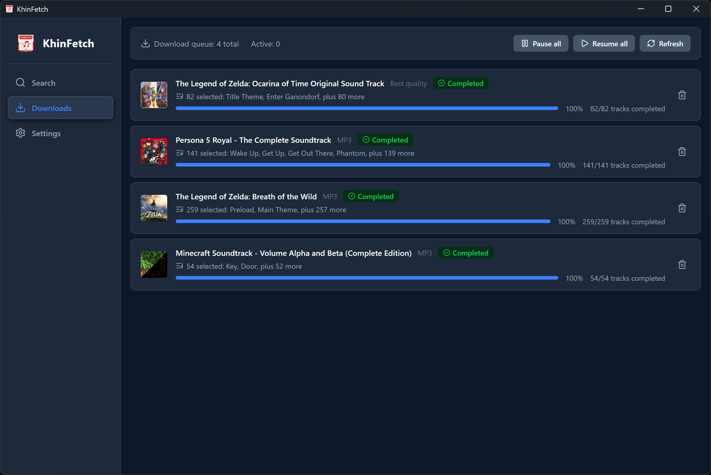

<p align="center">
  
</p>

<h1 align="center">KhinFetch</h1>

<p align="center">
  面向 Khinsider 游戏音乐原声资源的非官方跨平台桌面下载管理器。
</p>

<p align="center">
  <a href="./README.md">English</a>
  ·
  <a href="./LICENSE">GPL-3.0-or-later</a>
</p>

> [!NOTE]
> 本项目和 README 由 AI 辅助生成

> [!IMPORTANT]
> KhinFetch 是独立开发的非官方客户端，与 Khinsider 不存在从属、授权、认可或维护关系。本项目不会授予用户对音乐、封面、元数据或其他第三方内容的任何权利。用户有责任确保其使用和下载行为合法，并遵守相关网站条款。

## 功能

- 搜索 Khinsider 专辑，或直接打开专辑及播放列表链接。
- 选择单独曲目，或批量添加多个专辑和播放列表链接。
- 优先下载最佳可用音质，或仅下载 MP3。
- 可选择在音频文件旁保存专辑原始封面。
- 暂停、恢复、重试、取消并查看持久化下载任务。
- 通过 SQLite 下载队列恢复意外中断的任务。
- 支持简体中文和英文界面，以及浅色、深色和跟随系统主题。

## 界面截图

### 搜索



### 下载队列



## 项目状态

KhinFetch 仍在积极开发中。源码构建面向 Windows、macOS 和 Linux，CI 会在三个平台上进行编译验证。GitHub Releases 可能提供预构建安装包；除非具体版本另有说明，这些安装包目前不含代码签名。

Windows 版本还会提供 portable ZIP 压缩包，解压后直接运行 `KhinFetch.exe` 即可，无需安装。免安装版仍会将设置、数据库和日志写入当前用户的应用数据目录。

## 开发

### 环境要求

- Node.js 26.x
- pnpm 11.20.x
- Rust 1.97 或更高版本
- [Tauri 文档](https://v2.tauri.app/start/prerequisites/)中列出的对应平台依赖

### 本地运行

```bash
pnpm install --frozen-lockfile
pnpm tauri dev
```

### 验证改动

```bash
pnpm lint
pnpm build
cargo fmt --manifest-path src-tauri/Cargo.toml --all -- --check
cargo clippy --manifest-path src-tauri/Cargo.toml --all-targets --locked -- -D warnings
cargo test --manifest-path src-tauri/Cargo.toml --locked
```

### 构建桌面应用

```bash
pnpm tauri build
```

在宿主平台支持的情况下，未签名的本地安装包会输出到 `src-tauri/target/release/bundle/`。

## 项目结构

- `src/`：React 与 TypeScript 前端
- `src/api/client.ts`：前端调用 Tauri 后端的统一边界
- `src/api/generated/`：与 Rust DTO 对应的 TypeScript 类型
- `src/i18n/`：简体中文和英文界面文案
- `src/assets/`：前端及文档资源
- `docs/images/`：README 使用的界面截图
- `src-tauri/src/`：Rust 命令、下载、解析、存储、日志和文件系统逻辑
- `src-tauri/migrations/`：SQLite 迁移
- `src-tauri/icons/`：Tauri 各平台安装包图标
- `.github/workflows/`：持续集成与版本发布自动化

修改 `src-tauri/src/domain/` 中的公共 Rust DTO 时，必须在同一次改动中同步更新 `src/api/generated/` 下对应的 TypeScript 类型。

## 参与贡献

欢迎提交 Issue 和 Pull Request。请保持改动聚焦，保留项目的非官方客户端定位，并在提交 Pull Request 前运行上述验证命令。

## 致谢

- [Khinsider](https://downloads.khinsider.com/) 提供本应用所读取的网站数据。
- 项目实现参考了开源项目 [KhinsiderDownloader](https://github.com/weespin/KhinsiderDownloader)。

## 许可证

版权所有 (C) 2026 KhinFetch contributors。

除非文件中另有说明，本仓库内 KhinFetch 的原创源代码及项目自有资产均依据 **GNU 通用公共许可证第 3 版或任何后续版本**（`GPL-3.0-or-later`）授权。你可以按照该许可证使用、研究、修改和再分发 KhinFetch。分发修改版本或二进制文件时，必须遵守 GPL，包括适用的对应源代码提供义务。

KhinFetch 按“原样”提供，**不附带任何保证**，包括但不限于适销性或特定用途适用性的默示保证。完整许可证文本见 [LICENSE](./LICENSE)。

第三方依赖以及从外部服务取得的内容仍分别受其自身许可证、著作权和条款约束。KhinFetch 的开源许可证不会对这些第三方内容重新授权，也不会授予用户相关内容权利。
